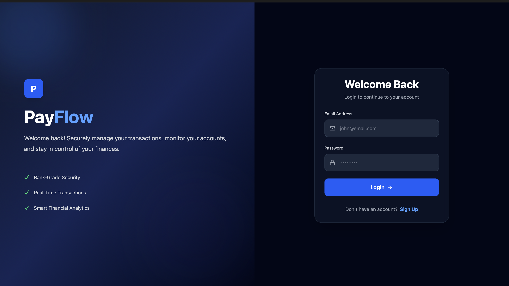
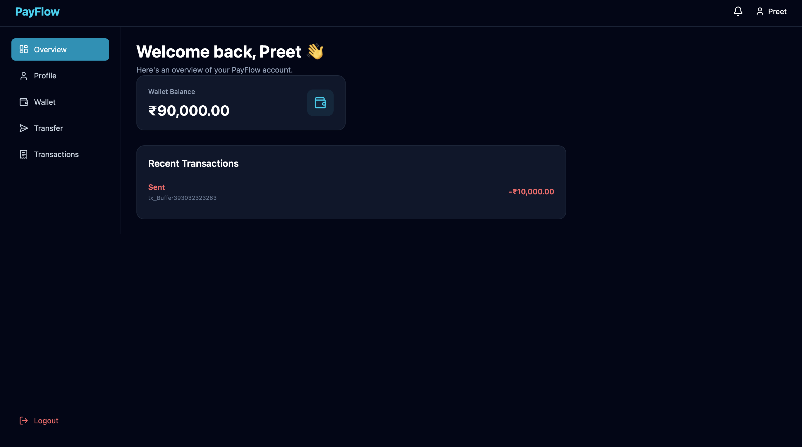
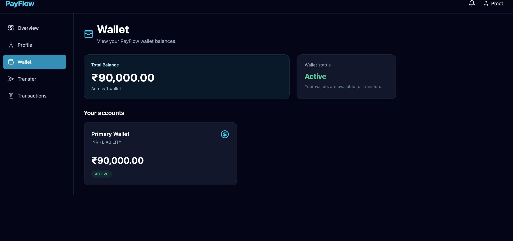
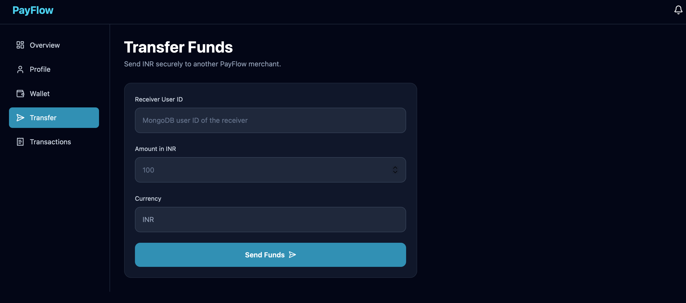
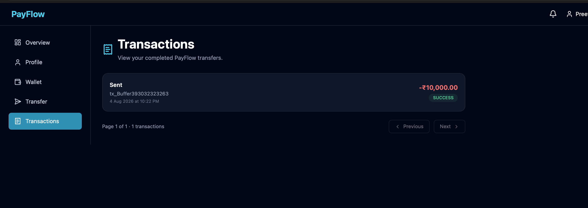
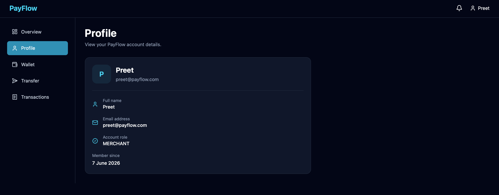

<div align="center">

# 💸 PayFlow

### Production-grade payment ledger & transaction engine

Double-entry bookkeeping · ACID transactions · Idempotent transfers · Role-based security


</div>

---

## 📖 About

**PayFlow** is a full-stack (MERN) fintech platform that lets merchants hold INR wallets and transfer funds to each other safely. Instead of simply incrementing and decrementing a balance field, PayFlow records every movement as an **immutable double-entry ledger transaction**, the same principle used by real banks and payment processors.

The backend follows a strict **Repository → Service → Controller** architecture, keeping business rules, persistence, and HTTP concerns fully separated and easy to test.

## 📸 Screenshots

<table>
  <tr>
    <td align="center"><b>Login</b><br></td>
    <td align="center"><b>Overview</b><br></td>
  </tr>
  <tr>
    <td align="center"><b>Wallet</b><br></td>
    <td align="center"><b>Transfer Funds</b><br></td>
  </tr>
  <tr>
    <td align="center"><b>Transactions</b><br></td>
    <td align="center"><b>Profile</b><br></td>
  </tr>
</table>

## ✨ Features

| | Feature | Description |
|---|---|---|
| 🔐 | **Secure authentication** | Registration and login with `bcrypt` salted hashing and JWT sessions |
| 🛡️ | **Role-based access control** | `auth` and `restrictTo` guards for `MERCHANT`, `ADMIN` and `AUDITOR` roles |
| 📒 | **Double-entry ledger** | Every transaction has balanced debit and credit lines that always sum to zero |
| ⚛️ | **ACID transfers** | MongoDB sessions keep multi-document writes atomic |
| 🔁 | **Idempotency** | Unique request keys stop duplicate transfers from being processed twice |
| ✅ | **Request validation** | Joi schemas reject malformed payloads before they reach the database |
| 🚨 | **Centralised error handling** | A custom `AppError` hierarchy and a global error interceptor |
| 📝 | **Request logging** | Global `logger` and `reqinfo` middleware for observability |
| 🖥️ | **Merchant dashboard** | React UI for balance, wallet, transfers and paginated transaction history |

## 🏦 Core Principle: Double-Entry Bookkeeping

PayFlow never "edits a balance". Every movement of money is a transaction made of at least two entries:

```
Transfer ₹10,000  (Sender → Receiver)

  Sender wallet     Debit   −₹10,000
  Receiver wallet   Credit  +₹10,000
  ───────────────────────────────────
  Sum of all entries          ₹0       ✔ invariant enforced
```

The invariant **Σ Debits + Σ Credits = 0** is enforced at the database layer with a pre-save hook, so money can never be created or destroyed. It can only move between accounts (`ASSET`, `LIABILITY`, etc.).

## 🏗️ Architecture

```
PayFlow/
├── Frontend/                 # React client (dashboard UI)
└── Backend/                  # Node.js / Express transaction engine
    ├── config/               # Database connection
    ├── controller/           # HTTP orchestration & responses
    ├── errors/               # Custom operational exceptions (AppError)
    ├── middleware/           # Auth guards, validators, logger
    ├── model/                # Mongoose schemas (User, Account, Transaction)
    ├── repositories/         # Data-access abstraction over raw queries
    ├── routes/               # REST endpoint declarations
    ├── services/             # Business rules & hashing
    ├── utils/                # JWT helpers, wrappers
    └── app.js                # App bootstrap & global middleware pipeline
```

**Request flow**

```
Client → Route → Middleware (auth · RBAC · Joi) → Controller → Service → Repository → MongoDB
```

## 🧰 Tech Stack

| Layer | Technology |
|---|---|
| Frontend | React.js |
| Backend | Node.js, Express |
| Database | MongoDB, Mongoose |
| Auth & security | JWT, bcrypt, RBAC |
| Validation | Joi |

## 🚀 Getting Started

### Prerequisites

- Node.js 18+
- MongoDB running as a **replica set** (required for multi-document ACID transactions). A free [MongoDB Atlas](https://www.mongodb.com/atlas) cluster works out of the box.

### 1. Clone the repository

```bash
git clone https://github.com/Pranav-MRK/PayFlow.git
cd PayFlow
```

### 2. Run the backend

```bash
cd Backend
npm install
```

Create a `.env` file in `Backend/`:

```env
PORT=5000
MONGO_URI=your_mongodb_connection_string
JWT_SECRET=your_super_secret_key
```

> Adjust the variable names to match your `config/` and `utils/` files.

```bash
npm run dev
```

### 3. Run the frontend

```bash
cd Frontend
npm install
npm run dev
```

Open the URL printed in the terminal (usually `http://localhost:5173`).

## 🔄 How a Transfer Works

1. The sender enters the **receiver's user ID**, the **amount** and the currency (INR).
2. The request passes through authentication and Joi validation.
3. The service opens a MongoDB session and starts a transaction.
4. A balanced debit and credit pair is written to the ledger, and both wallet balances are updated atomically.
5. On success the transaction is committed and recorded as `SUCCESS`. On any failure the whole operation is rolled back.

## 🗺️ Roadmap

- [x] **Day 1:** Architecture, authentication core and RBAC
- [x] **Day 2:** Double-entry models, zero-sum pre-save hooks and repositories
- [x] **Frontend:** Login, overview, wallet, profile, transfer and transactions pages
- [ ] **Day 3:** Full ledger revision and MongoDB ACID transaction services
- [ ] **Day 4:** Idempotency middleware using unique request fingerprint keys
- [ ] **Day 5:** Multi-account real-time balance verification aggregations
- [ ] **Day 6:** Webhook callback simulation with exponential backoff

## 🤝 Contributing

Contributions, issues and feature requests are welcome. Feel free to open an [issue](https://github.com/Pranav-MRK/PayFlow/issues) or submit a pull request.

## 👤 Author

**Pranav** · [@Pranav-MRK](https://github.com/Pranav-MRK)

---

<div align="center">

⭐ If you found this project useful, consider giving it a star!

</div>
